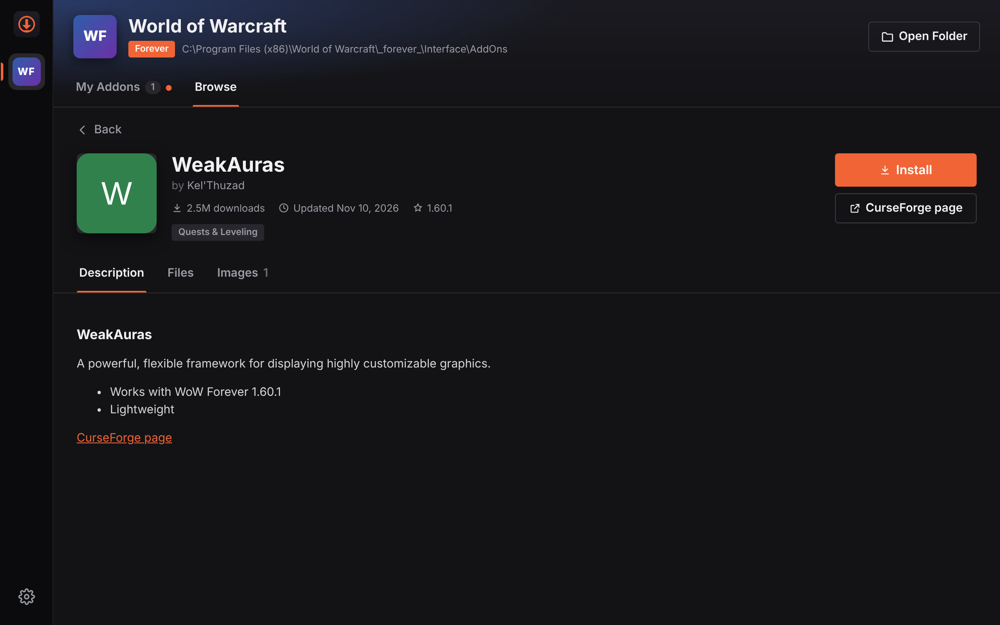

# EzAddon

A small, fast Windows app for finding and installing **World of Warcraft: Forever** addons from CurseForge.

**[⬇ Download the latest build for Windows (EzAddon-setup.exe)](https://github.com/RitualKit/EzAddon/releases/download/latest/EzAddon-setup.exe)**. An [.msi installer](https://github.com/RitualKit/EzAddon/releases/download/latest/EzAddon.msi) is also available, and older versions are on the [Releases](https://github.com/RitualKit/EzAddon/releases) page.


| Addon page | My Addons |
|---|---|
|  |  |

<sub>The screenshots use sample data.</sub>

- Browse every WoW Forever addon on CurseForge by category, or search by name.
- Sort by popularity, downloads, last updated, newest or name.
- Install with one click. Required dependencies are installed automatically.
- See what you've installed, check for updates, update one addon or all of them, and uninstall.
- **Scan for addons** finds addons you installed by hand or with another manager, identifies the exact version on CurseForge, and adds them to My Addons for update checks.
- Close to the system tray. EzAddon checks for addon updates in the background and shows a Windows notification when there are new ones.
- EzAddon updates itself: new versions install automatically when it starts.
- It only shows WoW Forever. Retail, Classic and other games are hidden.

It's built with [Tauri](https://tauri.app) and Svelte, so it uses Windows' built-in WebView2 instead of bundling a browser. The installer is a few MB and the app uses far less memory than Electron-based managers. It does nothing in the background while it's idle.

## Getting started

1. Download and run [EzAddon-setup.exe](https://github.com/RitualKit/EzAddon/releases/download/latest/EzAddon-setup.exe). It installs for your user only, so no admin rights are needed.
   - Windows SmartScreen may warn about an unrecognized app because the installer isn't code-signed yet. Click **More info → Run anyway**.
2. **CurseForge API key:**
   - Sign in at [console.curseforge.com](https://console.curseforge.com/) and create a free API key.
   - Paste it into EzAddon.
   - The key is stored in Windows Credential Manager and is only sent to `api.curseforge.com`.
3. **WoW folder:** click **Detect**, or use **Browse…** to pick your `World of Warcraft` folder.
   - Addons go into `World of Warcraft\_forever_\Interface\AddOns`.
   - You can also pick the `_forever_` folder or the `AddOns` folder directly.

## Performance

EzAddon is built to stay light:

- **Tiny in the tray.**
  - Closing the window to the tray destroys the window and its WebView2 processes instead of hiding them. Only the small native process stays running, and the window is rebuilt when you reopen it.
  - In the tray, EzAddon checks for updates once every 6 hours (first check 10 minutes after launch) and is otherwise idle.
  - Turn off **Close to tray** in Settings to have closing the window exit the app, or quit any time from the tray menu.
- **Small footprint.**
  - The app is a ~5 MB native binary that uses Windows' built-in WebView2, so it ships no browser of its own. The UI bundle is ~42 KB gzipped.
  - While the window is minimized, WebView2 is asked to trim its memory.
  - Long result lists only lay out and paint the rows on screen.
- **Fast browsing.**
  - The CurseForge game-version id and category list are fetched while the window opens, and cached (categories for 24 h on disk).
  - Concurrent lookups share a single request, and recently opened addon pages are kept in a small in-memory cache.
  - HTTP connections are reused, and idle ones close after 60 s.
- **Checked for leaks.** `scripts/leak-test.cjs` runs 240 browse / addon page / search / tab cycles and measures after forced garbage collection.
  - DOM nodes and event listeners stay exactly flat.
  - The JS heap levels off at about 3.8 MB.
- **Measured on Windows.** Every CI build launches the real app on a Windows runner (`scripts/measure-memory.ps1`) and records its memory use in the **Build** workflow's run summary. The latest results:

  | State | Processes | Private memory (what Task Manager counts) | Working set* | CPU while idle |
  |---|---|---|---|---|
  | Window open | 7 (app + WebView2) | **~105 MB** | ~315 MB | 0.04 % |
  | Minimized | 7 | ~105 MB | ~280 MB | 0.08 % |
  | **Closed to tray** | **1** | **4.6 MB** | 28 MB | **0 %** |

  <sub>*Working set also counts DLLs shared with Edge and Windows, so it overstates the real cost.</sub>

## Website-only addons

About a third of WoW Forever addons on CurseForge are set by their authors to allow downloads **only from the CurseForge website**. CurseForge enforces this for third-party apps like EzAddon, and in some categories (Garrison, Demon Hunters, Bags & Inventory…) it's most of them.

- These addons show a **CurseForge ↗** button instead of Install. **Hide website-only** in Browse removes them from the list.
- To use one, download it from the website and extract it into your AddOns folder. Then run **My Addons → Scan for Addons**, and EzAddon will track it and show when updates are out (with an **Update on CurseForge** link).

## Scanning for addons

**My Addons → Scan for Addons** looks at every folder in your AddOns folder that EzAddon doesn't already manage:

1. It computes each folder's fingerprint the same way CurseForge does (every file the addon's `.toc` loads, including `_Forever.toc` variants) and asks CurseForge which addon and exact file it is. Addons with a missing or extra module are still recognized.
2. If a folder isn't recognized but its `.toc` declares `## X-Curse-Project-ID`, it's added with an unknown version. Updating it once brings it to the latest version.
3. Anything else (your own tweaks, edited addons, Blizzard folders) is listed and left alone.

## Troubleshooting: API key not accepted, or search doesn't work

EzAddon tests your key with two requests: one any valid key may make, and the World of Warcraft addon search it actually needs. The result appears under the key field. You can run it again any time with **Settings → Test key**.

- **HTTP 401 (key not recognized):** copy the key again from [console.curseforge.com](https://console.curseforge.com/) using its copy button, or generate a new one.
- **HTTP 403 on both checks:** the key was refused. It may be revoked or not active yet. Generate a new key in the console. Some people have also had to rename their console organization before a new key worked.
- **General access ✓ but World of Warcraft ✗ (HTTP 403):** the key works, but CurseForge refuses WoW requests for it. Check your project in the console, or generate a new key.
- **A response mentioning CloudFront or Cloudflare:** CurseForge's CDN refused the request. This can also mean your network or IP is being blocked or rate-limited. Try again later or on another network.
- **HTTP 429:** CurseForge is rate-limiting you. Wait a minute.
- **No response:** check your internet connection, firewall, antivirus or proxy.

If the check fails you can still click **Save anyway** and browse; any error then shows CurseForge's exact answer. **Copy details** copies the full check (never the key itself) so you can include it in a bug report.

## EzAddon updates

EzAddon checks GitHub for a new version shortly after it starts and every 6 hours. With **Settings → Update EzAddon automatically** on (the default), a new version found at startup installs right away and EzAddon restarts. Otherwise a banner offers **Restart and update**. Updates are signed, and EzAddon only installs builds signed with the project's key.

## System tray

- **Left-click** the tray icon to open EzAddon.
- **Right-click** it for **Open EzAddon**, **Check for updates** and **Quit EzAddon**.
- The icon's tooltip shows how many addon updates are available.
- Launching EzAddon again while it's in the tray reopens the existing window instead of starting a second copy.

## How installs work

1. EzAddon picks the newest WoW Forever file for the addon, following your release channel (Release, Beta or Alpha).
2. It downloads the zip and unpacks it into a temporary folder inside `AddOns`. Archive entries that would write outside that folder are rejected.
3. It moves the addon folders into place. Existing copies are kept as backups until the move succeeds, and restored if it fails.
4. It records what it installed in `%APPDATA%\com.ritualkit.ezaddon\installed.json`. Uninstalling removes only the folders EzAddon put there, and never a folder another installed addon still uses.

**Third-party downloads:** some authors don't allow downloads from third-party apps. For those addons, EzAddon shows an **Open on CurseForge** button instead of installing.

**Addons installed outside EzAddon:** v1 doesn't track addons you installed manually or with another manager, and leaves them alone.

**Game version:** EzAddon finds CurseForge's WoW Forever game-version id automatically. If CurseForge ever changes it, you can override it in **Settings → Advanced**.

## Development

You need Node 22+, the Rust toolchain (stable, 1.90+), and on Windows the [Tauri prerequisites](https://tauri.app/start/prerequisites/).

```bash
npm install
```

Run the full app with hot reload:

```bash
npm run tauri dev
```

Run the UI only, in a browser, against a mock backend:

```bash
npm run dev
```

Check the UI for memory leaks (needs Playwright):

```bash
VITE_MOCK=1 npx vite build --outDir dist-mock && npx vite preview --outDir dist-mock --port 4173
```

```bash
node scripts/leak-test.cjs 12 20
```

Run the checks:

```bash
npm run check
```

```bash
cd src-tauri && cargo test && cargo clippy --all-targets
```

Build the installers (on Windows) into `src-tauri/target/release/bundle/`:

```bash
npm run tauri build
```

For local testing you can set the `EZADDON_CF_API_KEY` environment variable instead of saving a key in the app.

CI (`.github/workflows/build.yml`) does the following on every push:
- Runs the checks on Linux.
- Builds the NSIS `.exe` and `.msi` installers on Windows and measures the app's memory use.
- On the default branch, replaces the rolling **latest** pre-release that the download links above point to.

Pushing a `v*` tag also creates a versioned release.

Each CI build is numbered `0.1.<run number>`. For EzAddon's self-update, the repository needs the updater signing key as an Actions secret:
- `TAURI_SIGNING_PRIVATE_KEY` holds the private key's file contents. Its public key is in `src-tauri/tauri.conf.json` under `plugins.updater.pubkey`.
- `TAURI_SIGNING_PRIVATE_KEY_PASSWORD` is optional; leave it unset if the key has no password.

With the secret set, the build signs the installer and publishes `latest.json` next to it in the **latest** release. Without it, builds still work but can't be delivered as automatic updates.

### Layout

| Path | What it is |
|---|---|
| `src-tauri/src/curseforge.rs` | CurseForge API client, file selection, category tree |
| `src-tauri/src/installer.rs` | dependency planning, download, safe unzip, atomic folder swap |
| `src-tauri/src/manifest.rs` | the installed-addons manifest |
| `src-tauri/src/wow.rs` | WoW Forever folder detection |
| `src-tauri/src/scanner.rs` | addon scan: CurseForge-compatible folder fingerprints and matching |
| `src-tauri/src/app_update.rs` | EzAddon's own signed auto-update |
| `src-tauri/src/tray.rs` | system tray and background update checks |
| `src-tauri/src/settings.rs` | settings and API key storage |
| `src-tauri/src/lib.rs` | Tauri commands |
| `src/` | Svelte 5 UI. `src/lib/mock.ts` is the browser-only mock backend |

EzAddon is not affiliated with Blizzard Entertainment or CurseForge/Overwolf.
