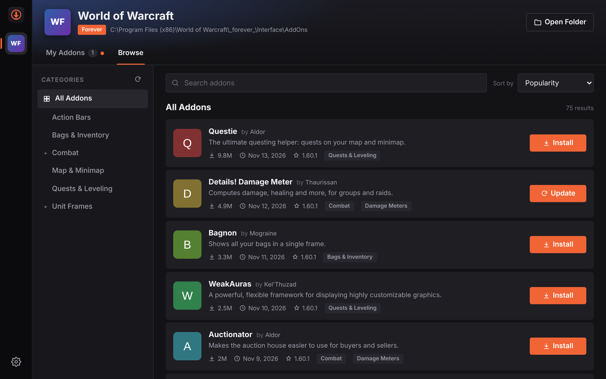
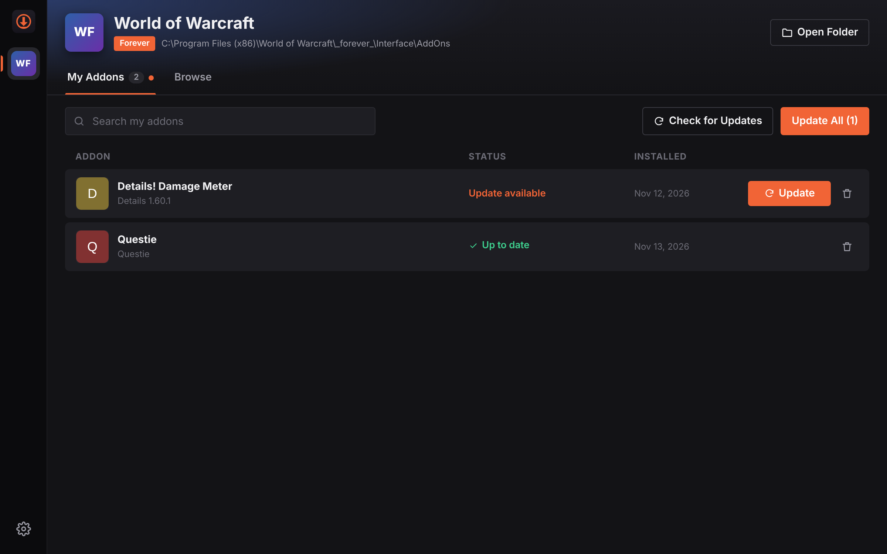

# EzAddon

A small, fast Windows app for finding and installing **World of Warcraft: Forever** addons from CurseForge.

**[⬇ Download the latest build for Windows (EzAddon-setup.exe)](https://github.com/RitualKit/EzAddon/releases/download/latest/EzAddon-setup.exe)**. An [.msi installer](https://github.com/RitualKit/EzAddon/releases/download/latest/EzAddon.msi) is also available, and older versions are on the [Releases](https://github.com/RitualKit/EzAddon/releases) page.



| Addon page | My Addons |
|---|---|
|  |  |

<sub>The screenshots use sample data.</sub>

- Browse every WoW Forever addon on CurseForge by category, or search by name.
- Sort by popularity, downloads, last updated, newest or name.
- Install with one click. Required dependencies are installed automatically.
- See what you've installed, check for updates, update one addon or all of them, and uninstall.
- It only shows WoW Forever. Retail, Classic and other games are hidden.

It's built with [Tauri](https://tauri.app) and Svelte, so it uses Windows' built-in WebView2 instead of bundling a browser. The installer is a few MB and the app uses far less memory than Electron-based managers. It does nothing in the background while it's idle.

## Getting started

1. Download and run [EzAddon-setup.exe](https://github.com/RitualKit/EzAddon/releases/download/latest/EzAddon-setup.exe). It installs for your user only, so no admin rights are needed.
   - Windows SmartScreen may warn about an unrecognized app because the installer isn't code-signed yet. Click **More info → Run anyway**.
2. **CurseForge API key:**
   - Sign in at [console.curseforge.com](https://console.curseforge.com/) and create a free API key.
   - Paste it into EzAddon.
   - The key is stored in Windows Credential Manager and is only sent to `api.curseforge.com`.
3. **WoW folder:** click **Detect**, or use **Browse…** to pick your `World of Warcraft` folder.
   - Addons go into `World of Warcraft\_forever_\Interface\AddOns`.
   - You can also pick the `_forever_` folder or the `AddOns` folder directly.

## Performance

EzAddon is built to stay light:

- **No background activity.** There is no tray icon, background service or polling. Update checks run only when you open **My Addons** or click **Check for Updates**. Closing the window exits the app completely.
- **Small footprint.**
  - The app is a ~5 MB native binary that uses Windows' built-in WebView2, so it ships no browser of its own. The UI bundle is ~42 KB gzipped.
  - While the window is minimized, WebView2 is asked to trim its memory.
  - Long result lists only lay out and paint the rows on screen.
- **Fast browsing.**
  - The CurseForge game-version id and category list are fetched while the window opens, and cached (categories for 24 h on disk).
  - Concurrent lookups share a single request, and recently opened addon pages are kept in a small in-memory cache.
  - HTTP connections are reused, and idle ones close after 60 s.
- **Checked for leaks.** `scripts/leak-test.cjs` runs 240 browse / addon page / search / tab cycles and measures after forced garbage collection.
  - DOM nodes and event listeners stay exactly flat.
  - The JS heap levels off at about 3.8 MB.
- **Measured on Windows.** Every CI build launches the real app on a Windows runner and records memory use (app plus WebView2 processes, active and minimized) in the run summary of the **Build** workflow.

## How installs work

1. EzAddon picks the newest WoW Forever file for the addon, following your release channel (Release, Beta or Alpha).
2. It downloads the zip and unpacks it into a temporary folder inside `AddOns`. Archive entries that would write outside that folder are rejected.
3. It moves the addon folders into place. Existing copies are kept as backups until the move succeeds, and restored if it fails.
4. It records what it installed in `%APPDATA%\com.ritualkit.ezaddon\installed.json`. Uninstalling removes only the folders EzAddon put there, and never a folder another installed addon still uses.

**Third-party downloads:** some authors don't allow downloads from third-party apps. For those addons, EzAddon shows an **Open on CurseForge** button instead of installing.

**Addons installed outside EzAddon:** v1 doesn't track addons you installed manually or with another manager, and leaves them alone.

**Game version:** EzAddon finds CurseForge's WoW Forever game-version id automatically. If CurseForge ever changes it, you can override it in **Settings → Advanced**.

## Development

You need Node 22+, the Rust toolchain (stable, 1.90+), and on Windows the [Tauri prerequisites](https://tauri.app/start/prerequisites/).

```bash
npm install
```

Run the full app with hot reload:

```bash
npm run tauri dev
```

Run the UI only, in a browser, against a mock backend:

```bash
npm run dev
```

Check the UI for memory leaks (needs Playwright):

```bash
VITE_MOCK=1 npx vite build --outDir dist-mock && npx vite preview --outDir dist-mock --port 4173
```

```bash
node scripts/leak-test.cjs 12 20
```

Run the checks:

```bash
npm run check
```

```bash
cd src-tauri && cargo test && cargo clippy --all-targets
```

Build the installers (on Windows) into `src-tauri/target/release/bundle/`:

```bash
npm run tauri build
```

For local testing you can set the `EZADDON_CF_API_KEY` environment variable instead of saving a key in the app.

CI (`.github/workflows/build.yml`) does the following on every push:
- Runs the checks on Linux.
- Builds the NSIS `.exe` and `.msi` installers on Windows and measures the app's memory use.
- On the default branch, replaces the rolling **latest** pre-release that the download links above point to.

Pushing a `v*` tag also creates a versioned release.

### Layout

| Path | What it is |
|---|---|
| `src-tauri/src/curseforge.rs` | CurseForge API client, file selection, category tree |
| `src-tauri/src/installer.rs` | dependency planning, download, safe unzip, atomic folder swap |
| `src-tauri/src/manifest.rs` | the installed-addons manifest |
| `src-tauri/src/wow.rs` | WoW Forever folder detection |
| `src-tauri/src/settings.rs` | settings and API key storage |
| `src-tauri/src/lib.rs` | Tauri commands |
| `src/` | Svelte 5 UI. `src/lib/mock.ts` is the browser-only mock backend |

EzAddon is not affiliated with Blizzard Entertainment or CurseForge/Overwolf.
